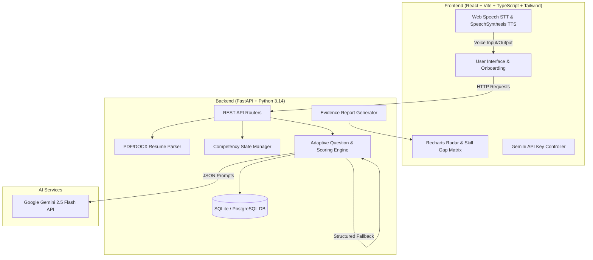

# ProofHire AI — Realistic Adaptive Interview Intelligence Platform

> **Google Student Club Welcome Hackathon 2026 Submission**  
> *Production-style AI interviewer conducting context-dependent adaptive technical interviews grounded in resume claims, job requirements, and real-time answer evidence.*

---

## 🌟 Overview

**ProofHire AI** transforms technical hiring from static, repetitive question lists into dynamic, human-like adaptive conversations. Built for engineering candidates and recruiters, ProofHire AI evaluates candidates in real-time across candidate-claimed skills, job description needs, and live answer quality.

Unlike rigid mock interview bots, ProofHire AI:
- **Listens & Adapts**: Evaluates candidate answers on a structured **0–4 evidence rubric** across 5 dimensions.
- **Probes Deeply**: Asks contextually relevant follow-up questions when answers are vague or high-level.
- **Pivots Professionally**: Respects candidate admission of unfamiliarity ("I don't know") without penalizing honesty, gracefully transitioning to alternative unassessed competencies.
- **Quantifies Skill Gaps**: Constructs a visual **Resume-to-Job Skill Gap Matrix** comparing claimed skills vs. job description needs vs. demonstrated interview evidence.
- **Provides Decision Support**: Delivers evidence-backed reports with radar score charts, question-by-question AI reasoning, practice recommendations, and personalized learning roadmaps.

---

## 📐 System Architecture



---

## ✨ Key Features & Technical Highlights

### 1. Resume & Job Setup Workflow
- **Multi-format Resume Ingestion**: Supports PDF, DOCX, and raw text input with automated skill, project, and experience parsing via Gemini / heuristic extraction.
- **Editable Skills Review**: Allows candidates to review and fine-tune extracted skills before starting.
- **1-Click Candidate Presets**: Includes pre-configured sample candidate profiles (Alex Chen - Python Intern, Maya Lin - Frontend Developer, Rahul Sharma - ML Engineer) for instant demonstration.

### 2. Realistic Adaptive Conversation
- **Context-Aware Follow-ups**: Evaluates previous answer depth and generates custom follow-up questions with internal JSON reasoning (`reason_for_next_question`).
- **Difficulty & Focus Customization**: Support for 10/20/30-minute durations, beginner/intermediate/advanced difficulty, and technical/behavioral/mixed focus.
- **Voice & Speech Synthesis**: Browser Web Speech STT transcription and TTS audio playback with visual equalizer waveforms.

### 3. Evidence-Based Evaluation & Rubrics
- **0–4 Scale Grading**: Graded across Technical Correctness, Depth of Understanding, Problem Solving, Clarity of Explanation, and Question Relevance.
- **Quote Extraction**: Captures verbatim candidate quotes to back up every score.
- **Fairness & Accessibility**: Accepts alternative valid technical approaches without penalizing accents or grammar differences.

### 4. Recruiter Dashboard & Decision Support
- **Pool Comparative Ranking**: Aggregated scoring table sorting candidates by evidence scores.
- **Role Benchmarks**: Statistical performance metrics across target engineering roles.
- **Report PDF Export**: Print-ready styled evaluation reports.

---

## 🛠️ Tech Stack

- **Frontend**: React 18, Vite 6, TypeScript, Tailwind CSS v4, Recharts, Lucide Icons, Canvas Confetti.
- **Backend**: Python 3.14, FastAPI, Uvicorn, SQLAlchemy, Pydantic v2, PyPDF, Python-Docx, Pytest.
- **AI Integration**: Google Gemini API (`gemini-2.5-flash`) via `google-genai` / REST API with structured JSON schema enforcement and standard fallback engine.
- **Database**: SQLite (`proofhire.db`) or PostgreSQL.

---

## 🚀 Quickstart & Local Setup

### Prerequisites
- Python 3.10+
- Node.js v18+ and npm

### 1. Clone & Setup Repository
```bash
git clone https://github.com/your-org/proofhire-ai.git
cd proofhire-ai
```

### 2. Backend Setup
```bash
# Create virtual environment
python -m venv venv

# Activate virtual environment
# Windows:
.\venv\Scripts\activate
# Linux/macOS:
source venv/bin/activate

# Install dependencies
pip install -r requirements.txt
```

### 3. Frontend Setup
```bash
cd frontend
npm install
npm run build
cd ..
```

### 4. Run Application Server
```bash
# Start backend (also serves built frontend on http://localhost:8000)
python backend/main.py
```
Open **`http://localhost:8000`** in your browser!

---

## 🧪 Automated Testing

Run the backend unit test suite:
```bash
# Run pytest from root directory
.\venv\Scripts\pytest backend/tests
```

---

## 🔑 Environment Variables (.env)

Create a `.env` file in the project root:
```env
GEMINI_API_KEY=your_gemini_api_key_here
GEMINI_MODEL=gemini-2.5-flash
DATABASE_URL=sqlite:///./proofhire.db
PORT=8000
```
> *Note: If `GEMINI_API_KEY` is omitted, ProofHire AI automatically activates its adaptive rule engine so the platform remains 100% functional out of the box.*

---

## 🌐 API Endpoint Reference

| Endpoint | Method | Description |
| :--- | :--- | :--- |
| `GET /api/system/status` | GET | Health status and Gemini API key status |
| `POST /api/resume/parse` | POST | Parses PDF/DOCX file or text into structured candidate skills |
| `POST /api/interviews/create` | POST | Initializes candidate, job description, and interview session |
| `POST /api/interviews/{id}/start` | POST | Starts session and generates Opening Question 1 |
| `POST /api/interviews/{id}/answer` | POST | Evaluates answer on rubric, updates competency map, returns adaptive Q_next |
| `POST /api/interviews/{id}/end` | POST | Finalizes interview and triggers report compilation |
| `GET /api/interviews/{id}/report` | GET | Retrieves evidence report with radar chart & skill gap matrix |
| `GET /api/recruiter/analytics` | GET | Recruiter candidate ranking pool and benchmarks |

---

## 📜 License

Distributed under the MIT License for Google Student Club Welcome Hackathon 2026.
