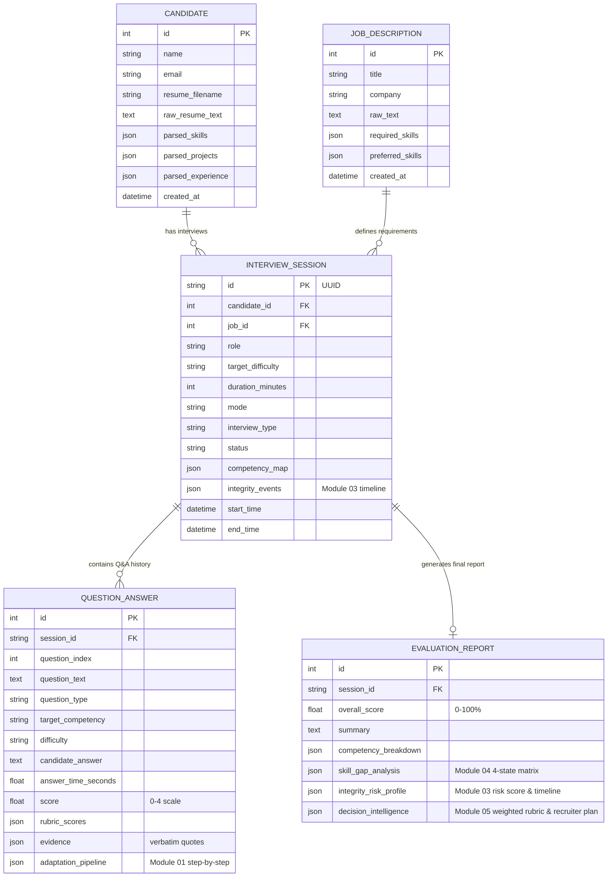

# ProofHire AI — Database Schema & Migrations

> **Supported Engines:** SQLite (`proofhire.db`) for zero-setup local dev / PostgreSQL / Supabase for production deployment.

---

## 📊 Database Schema Overview



---

## 🛠 Setup & Table Creation

To initialize or reset tables locally using SQLAlchemy `Base.metadata.create_all`:
```bash
# Set database connection string in .env (default: sqlite:///./proofhire.db)
DATABASE_URL=sqlite:///./proofhire.db
```
Tables are automatically created on backend startup via `backend/app/main.py`.
