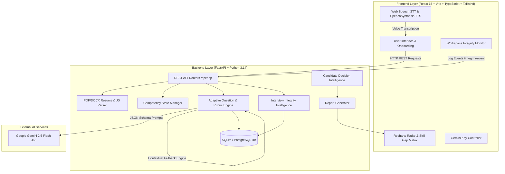

# ProofHire AI — System Architecture & Design Documentation

> **Google Student Club Welcome Hackathon 2026 Submission**  
> *Adaptive, Evidence-Driven Technical Interviewing & Decision Intelligence Platform*

---

## 1. High-Level System Architecture



---

## 2. Directory Layout & Monorepo Structure

```
ProofHire-AI/
├── frontend/                     # Member 1: Frontend Application
│   ├── src/
│   │   ├── components/           # RadarChart, SkillGapMatrix, VoiceWaveform, ApiKeyModal
│   │   ├── pages/                # Landing, Setup, InterviewRoom, Report, Recruiter, History
│   │   ├── services/             # api.ts, speech.ts
│   │   ├── types/                # TypeScript data interfaces (index.ts)
│   │   └── hooks/                # Custom React hooks (useTimer, useSpeech)
│   ├── package.json
│   └── README.md
├── backend/                      # Python FastAPI Application
│   ├── app/
│   │   ├── main.py               # FastAPI application initialization & routes
│   │   ├── api/                  # REST API Endpoints (resume, interviews, recruiter, health)
│   │   ├── core/                 # Config & Security settings
│   │   ├── schemas/              # Shared Pydantic validation schemas
│   │   ├── models/               # SQLAlchemy Database Models
│   │   ├── services/
│   │   │   ├── ai/               # Member 2: Gemini API Integration & Question Generation
│   │   │   ├── resume/           # Member 3: Resume & Job Intelligence Engine
│   │   │   ├── interview/        # Member 5: Interview Session Orchestration & Competencies
│   │   │   └── evaluation/       # Member 4: Rubric Evaluation, Integrity & Decision Intelligence
│   │   └── db/                   # Database engine & session management
│   ├── tests/                    # Pytest test suite (test_adaptive_engine.py)
│   └── requirements.txt
├── database/                     # DB Setup & Schema Documentation
│   ├── migrations/
│   └── README.md
├── docs/                         # Technical Specs & Architecture
│   ├── architecture.md           # System design & diagrams
│   ├── api-contracts.md          # OpenAPI / REST endpoint specifications
│   └── team-ownership.md         # 5-member team ownership boundaries & PR workflow
├── .env.example
├── .gitignore
└── README.md
```

---

## 3. Data Flow & Processing Lifecycle

1. **Resume & JD Parsing**: PDF/DOCX or raw text is ingested via PyPDF/python-docx and structured into candidate skills, projects, and job description requirements.
2. **Session Initialization**: An `InterviewSession` is created with a dynamic `competency_map` based on job requirements and candidate profile.
3. **Opening Question (Q1)**: Grounded in the candidate's resume project experience and role context.
4. **Adaptive Interview Loop**:
   - Candidate responds via Text or Voice Speech STT.
   - Evaluator evaluates answer on a **0–4 Rubric Scale** across 5 dimensions, extracting verbatim quote evidence.
   - Competency profile updates live (running average score, tested question indices, state transition: `demonstrated`, `partially_demonstrated`, `claimed_untested`, `not_demonstrated`, `unassessed`).
   - Module 01 Adaptation Engine determines untested skills, adjusts difficulty level, and produces an explainable 5-step decision pipeline:
     `Question Area → Competency Coverage → Question Relevance → Difficulty Selection → Next Question`.
5. **Integrity Intelligence**: Live workspace monitor logs events (`TAB_SWITCH`, `PASTE_DETECTED`, `SPEECH_PAUSE`). Events are aggregated temporally into an explainable risk profile.
6. **Decision Intelligence & Report**: Synthesizes weighted scores (Technical 40%, Problem Solving 25%, Depth 20%, Clarity 15%), 4-state Skill Gap Matrix, Role Alignment summary, verbatim evidence quotes, and recruiter action plans.
